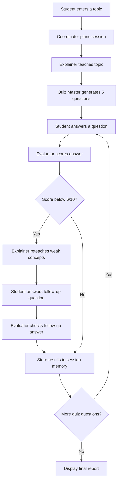

# Project Demo: 
## Project Demo

[](https://www.youtube.com/watch?v=5iFa2g5Fdzg&t=77s)

# Leo: Multi-Agent AI Tutor

Leo is a beginner-friendly AI tutoring application built with Python and CrewAI. It uses specialized AI agents to explain topics, generate quizzes, evaluate student answers, and provide targeted reteaching when a student struggles.

## Features

- **Coordinator:** Plans the learning session.
- **Explainer:** Explains a topic using beginner-friendly language and examples.
- **Quiz Master:** Generates five conceptual and practical questions.
- **Evaluator:** Evaluates each answer and provides constructive feedback.
- **Feedback loop:** When an answer scores below 6/10, Leo provides a targeted explanation and a follow-up question.
- **Session memory:** Stores the current topic, lesson, questions, answers, scores, evaluations, and reteaching information while the program is running.

## Technology Stack

- Python
- CrewAI
- Google Gemini API
- python-dotenv

## Project Structure

```text
Leo-Multi-Agent-Tutor/
├── agents/
│   ├── coordinator.py
│   ├── explainer.py
│   ├── quiz_master.py
│   └── evaluator.py
├── tasks/
│   ├── coordinator_task.py
│   ├── explanation_task.py
│   ├── quiz_task.py
│   ├── evaluation_task.py
│   └── reteaching_task.py
├── main.py
├── requirements.txt
├── .env
└── README.md
```

## Setup and Installation

### 1. Clone the repository

```bash
git clone YOUR_GITHUB_REPOSITORY_URL
cd Leo-Multi-Agent-Tutor
```

### 2. Create a virtual environment

```bash
python -m venv venv
```

Activate it on Windows PowerShell:

```powershell
.\venv\Scripts\Activate.ps1
```

### 3. Install dependencies

```bash
pip install -r requirements.txt
```

### 4. Configure the Gemini API key

Create a `.env` file in the project root:

```text
GEMINI_API_KEY=your_gemini_api_key
```

Use your own API key. Never commit the `.env` file to GitHub.

### 5. Run Leo

```bash
python main.py
```

Enter a topic when prompted, answer the five quiz questions, and review the evaluations and any reteaching activities.


## Architecture

Leo uses CrewAI's sequential process to coordinate the initial learning stages. The Python application then manages student responses, answer evaluation, and conditional reteaching.



### Orchestration Pattern

- **Sequential orchestration:** The Coordinator, Explainer, and Quiz Master run in sequence through CrewAI.
- **Student interaction:** The main Python program collects answers between quiz stages.
- **Conditional feedback loop:** Answers scoring below 6/10 trigger targeted reteaching and a follow-up evaluation.
- **Session memory:** A Python dictionary tracks the topic, questions, answers, evaluations, scores, and reteaching results during the current run.


## Memory

Leo uses an in-memory Python dictionary to record learning-session information. This memory is temporary and is lost when the program exits.

## Error Handling

Leo provides helpful messages when an agent fails, including when the Gemini API quota or rate limit is reached.

## Limitations

- Requires a working Gemini API key and available API quota.
- Session memory does not persist between program runs.
- Scores depend on the AI evaluator and may not always be perfectly consistent.

## Future Improvements

- Streamlit web interface.
- Persistent student progress and learning history.
- Improved answer evaluation and feedback.
- More interactive learning activities.
